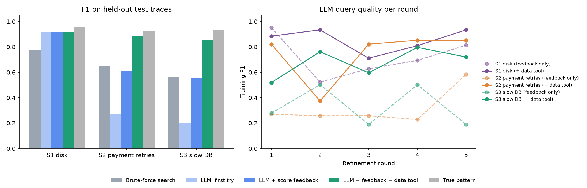

# LLM-assisted event query discovery

A small pilot experiment asking: **can an LLM discover a query that describes the event sequences leading to failures, and what does it need to do so reliably?**

## Setup

**Data (synthetic).** `make_traces.py` generates system event logs (sessions of events such as `Request`, `Retry`, `DBQuery`, `CacheMiss`, `DiskWarning`, `Timeout`) for three scenarios. In each, failing sessions contain a **hidden pattern**, while normal sessions contain look-alike distractors. 3% of labels are flipped to mimic label noise. Each scenario has 300 training and 300 held-out test traces.

| Scenario | Hidden failure pattern |
|---|---|
| S1 disk | `DiskWarning(usage > 90)` later followed by `WriteFail` |
| S2 payment retries | `Retry(service = payment)`, `Retry(service = payment)`, then `Timeout`, within 6 events |
| S3 slow DB | `CacheMiss` followed within 4 events by `DBQuery(latency > 800)` |

**Query language.** Ordered steps with optional attribute conditions and a maximum span (`query.py`). For example:
`{"steps": [{"type": "CacheMiss"}, {"type": "DBQuery", "where": {"latency": [">", 800]}}], "within": 4}`

**Methods.** All are evaluated on the held-out test traces, which the LLM never sees.

| Method | Description |
|---|---|
| Brute-force search | Tries every ordered sequence of 1–2 event *types* (no attribute conditions) and window sizes, keeps the best training F1. No AI. |
| LLM, first try | Gemini 3.5 Flash-Lite sees event types, attribute ranges and 6 failing + 6 normal example traces, and proposes a query |
| LLM + score feedback | Up to 5 rounds: a tool scores the query on the training data and shows the LLM 2 false positives and 2 false negatives; the best round by training F1 is kept |
| LLM + feedback + data tool | As above, plus the output of a data inspection tool: the 25 features (event types, attribute thresholds/values, ordered pairs) most over-represented in failing traces |
| True pattern | The hidden pattern itself, i.e. the best achievable score given the label noise |

## Results



Test F1:

| Scenario | Brute-force search | LLM, first try | LLM + score feedback | **LLM + feedback + data tool** | True pattern |
|---|---|---|---|---|---|
| S1 disk | 0.77 | 0.92 | 0.92 | **0.92** | 0.96 |
| S2 payment retries | 0.65 | 0.27 | 0.61 | **0.88** | 0.93 |
| S3 slow DB | 0.56 | 0.20 | 0.56 | **0.86** | 0.94 |

Score feedback alone helped only partly. Adding the data inspection tool let the LLM find the correct structure in all three scenarios: the payment condition in S2, and the cache miss before the slow query in S3.

## What the numbers do not show

1. **Refinement is not steady improvement.** The LLM often made a good query worse after feedback (S1: training F1 0.95 → 0.52; S2 with the data tool: 0.82 → 0.37). Keeping the best query across rounds was essential.
2. **The LLM copied the tool's thresholds.** With the data tool it used exactly the cut points the tool printed (`usage >= 92`, `latency > 1018`) and never tried other values, such as the true 800 ms. This is part of why S3 stays below the true pattern: how the tool summarises data shapes which queries the LLM can find.
3. **Without the data tool, the LLM repeated failed queries and justified them confidently.** In S3 it proposed queries that had already scored badly in earlier rounds, while stating that failing traces "consistently contain" features that the scores showed they did not.
4. The LLM never added the `within` limit in S2, which the true pattern has; on this data it made little difference.

## Limitations

- Synthetic data with planted patterns; real event logs are larger and messier.
- Three scenarios, one model, one run each (temperature 0.2): a pilot, not a benchmark.
- The brute-force baseline does not search attribute conditions. An attribute-aware search would be a stronger and fairer comparison.
- The data tool is a fixed summary given in the prompt, not a tool the LLM can call with its own questions.

## Possible next steps

- Let the LLM call inspection tools itself (for example "compare the distribution of attribute X in failing vs normal traces").
- Search thresholds numerically once the LLM has proposed the structure, combining LLM proposals with classic optimisation.
- Compare with an attribute-aware search baseline and with established sequential pattern mining methods.
- Test on a public labelled log dataset.

## How to run

```bash
python -m venv .venv
.venv\Scripts\activate          # Windows
pip install -r requirements.txt
copy .env.example .env          # then paste your Gemini API key into .env
python make_traces.py           # creates data/traces.json
python run.py                   # finished parts are saved, so re-running resumes
python make_chart.py
```

`python fake_test.py` checks the pipeline offline with a fake model.

## Files

| File | Purpose |
|---|---|
| `make_traces.py` | Generates the synthetic traces and hidden patterns |
| `query.py` | Query language, matcher and scoring |
| `baseline.py` | Brute-force search baseline |
| `llm_discover.py` | LLM proposal and refinement loop, and the data inspection tool |
| `run.py` | Runs all methods, evaluates on test traces, saves `results/results.json` |
| `make_chart.py` | Draws `results/chart.png` |
